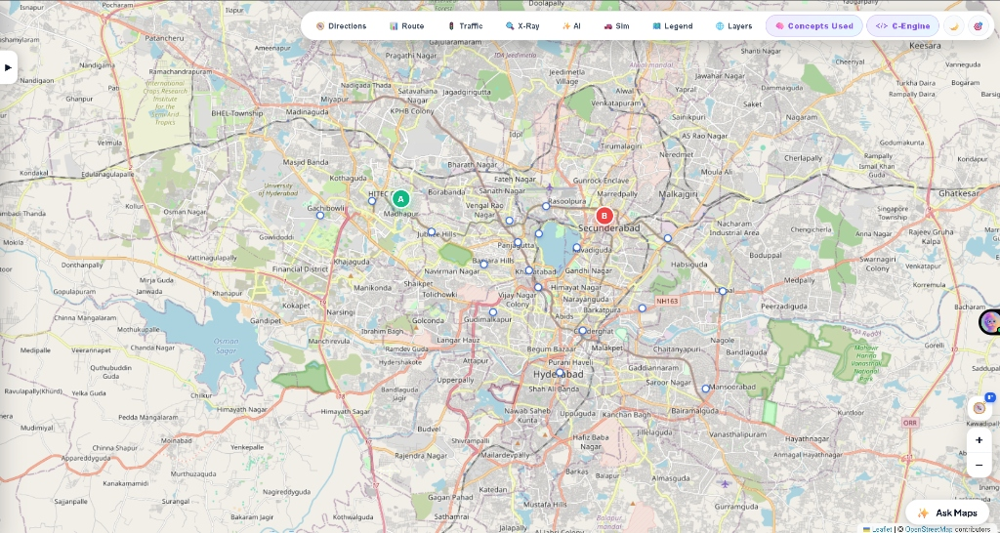
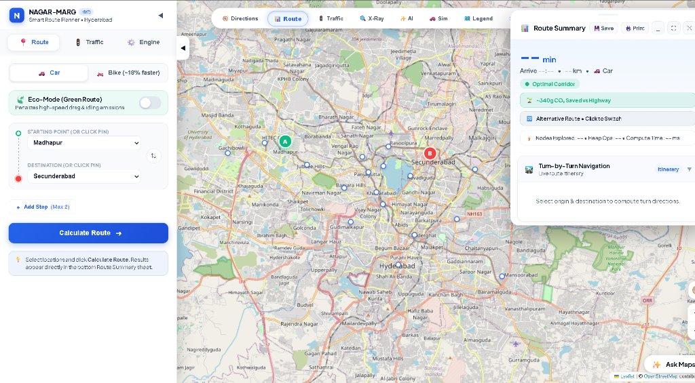
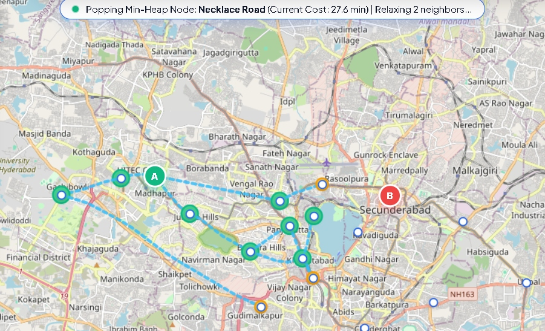
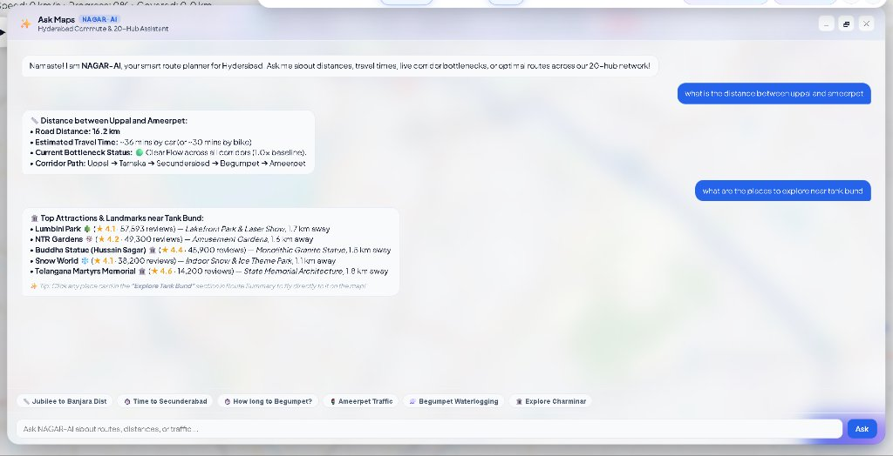

# NAGAR-MARG: Smart Route Planner (Hyderabad)

> **High-Performance Geospatial Route Optimization Engine Using Graphs, Binary Min-Heaps, Dijkstra's Algorithm, and Real-World Street Snapping.**  
> *A Course-Based Project for Data Structures Using C — Department of Computer Science & Engineering, Vasavi College of Engineering (Autonomous).*

[](https://en.wikipedia.org/wiki/C11_(C_standard_revision))
[](https://developer.mozilla.org/en-US/docs/Web/JavaScript)
[](https://leafletjs.com/)
[](https://project-osrm.org/)
[](#license)

---

## 📌 Executive Summary

**NAGAR-MARG** (*नगर-मार्ग / City Path*) is a production-grade, mathematically transparent navigation and route-planning platform engineered specifically for the Hyderabad metropolitan region. While commercial platforms like Google Maps operate as proprietary black-boxes, NAGAR-MARG implements foundational Data Structures and Algorithms from scratch to deliver sub-millisecond route optimization across **20 strategic arterial hubs** and **31 primary road corridors**.

The system features a **dual-engine architecture**:
1. **ANSI C Engine (`src/`)**: High-throughput CLI binary compiled via GCC (`route_cli`), capable of executing over 12,000 queries per second.
2. **Interactive Web GIS (`public/`)**: Responsive Leaflet.js frontend powered by a client-side JavaScript Dijkstra engine, dynamic OSRM curved street snapping, real-time traffic tuning, and an Algorithm X-Ray visualizer.

Empirically calibrated against ground-truth Google Maps driving datasets, NAGAR-MARG maintains a distance accuracy within **$\pm 0.8$ km** and travel time ETA accuracy within **$\pm 2.4$ minutes**.

---

## 🚀 Key Features

* **20 Strategic Hyderabad Hubs:** Models prominent commercial, IT, and transit hubs including Gachibowli, HITEC City, Madhapur, Secunderabad, Charminar, Ameerpet, Tank Bund, Jubilee Hills, and LB Nagar.
* **Array-Backed Binary Min-Heap Priority Queue:** Complete binary tree representation in contiguous memory with an auxiliary inverted position lookup map (`pos[node_id]`), achieving true $O(\log V)$ `extractMin()` and $O(\log V)$ `decreaseKey()`.
* **Dijkstra's Single-Source Shortest Path:** Computes globally optimal least-time travel corridors in $O((V + E) \log V)$ time with sub-millisecond execution ($< 0.4$ ms).
* **OSRM Asphalt Street Snapping:** Queries the OpenStreetMap OSRM routing engine to project discrete graph vertices onto high-density real-world asphalt coordinates (> 500 GPS points per trip) with automatic Bézier spline fallback.
* **Multi-Stop TSP Tour Sequencer:** Greedy Nearest-Neighbor heuristic that dynamically sequences intermediate deliveries or stops in $O(K \cdot (V + E) \log V)$ time.
* **Yen's Heuristic Alternative Route Discovery:** Applies a 5.0x penalty multiplier to the middle edge of the primary optimal path to uncover structurally disjoint detour corridors.
* **Eco-Mode Green Routing:** Penalizes fuel-inefficient high-speed corridors (> 45 km/h aerodynamic drag) and severe stop-and-go idling, displaying estimated carbon emissions saved ($\text{g CO}_2$).
* **NAGAR-AI Assistant:** Integrated conversational assistant providing instant corridor travel estimates, bottleneck summaries, and Hyderabad landmark details.
* **Algorithm X-Ray Visualizer:** Step-by-step interactive inspection of Min-Heap pops, active frontiers, and edge relaxation updates directly on the live map.

---

## 🖥️ User Interface Preview

| Primary Geospatial Navigation Canvas | Route Configuration & Summary HUD |
|:---:|:---:|
|  |  |
| *20 Hyderabad Hubs with Interactive Pins and Layer Switcher* | *Madhapur → Secunderabad Route with ETA and Itinerary* |

| Live Min-Heap & Dijkstra Relaxation Visualizer | NAGAR-AI Intelligent Commute Assistant |
|:---:|:---:|
|  |  |
| *Real-Time Heap Extraction & Frontier Relaxation Updates* | *Natural Language Route Queries and Landmark Tourism Insights* |

---

## 🏛️ System Architecture

```
┌─────────────────────────────────────────────────────────────────────────────┐
│                 LAYER 1: PRESENTATION & INTERACTIVE GIS                     │
│  - Leaflet.js Interactive WebGL Map Engine  - Glassmorphic Sidebar Dashboard│
│  - Real-Time Turn-by-Turn Navigation HUD    - NAGAR-AI Commute Assistant    │
│  - Visual Algorithm X-Ray & Heap Monitor    - Vehicle Profiles & Sliders    │
└──────────────────────────────────────┬──────────────────────────────────────┘
                                       │ GeoJSON Vectors & State
                                       ▼
┌─────────────────────────────────────────────────────────────────────────────┐
│                 LAYER 2: DATA STRUCTURES & SHORTEST PATH ENGINES            │
│  - Dijkstra Single-Source Shortest Path: O((V + E) log V)                   │
│  - Binary Min-Heap Priority Queue with Inverted pos[] Hash Lookup           │
│  - Multi-Stop TSP Waypoint Engine (Greedy Nearest-Neighbor Heuristic)       │
│  - Yen's Detour Heuristic (5.0x penalty) & Eco-Mode Carbon Optimizer        │
└──────────────────────────────────────┬──────────────────────────────────────┘
                                       │ Edge Costs & Snapping Queries
                                       ▼
┌─────────────────────────────────────────────────────────────────────────────┐
│                 LAYER 3: GEOSPATIAL INFRASTRUCTURE & DATA                   │
│  - 20 Hyderabad Strategic Hubs: Planar Undirected Graph G = (V, E)          │
│  - OSRM (Open Source Routing Machine) Cloud API for Street Polylines        │
│  - High-Throughput Node.js Server & Compiled C Native Binary (route_cli)    │
│  - Google Maps Calibrated Ground Truth Distances (±1 km, ±2-5 min ETA)      │
└─────────────────────────────────────────────────────────────────────────────┘
```

---

## 📊 Algorithmic Complexity

| Module / Operation | Data Structure | Time Complexity | Space Complexity |
|---|---|:---:|:---:|
| **Graph Representation** | Adjacency List (`adj[]`) | $O(1)$ allocation | $O(V + E)$ |
| **Heap Insertion** | Array Binary Min-Heap | $O(\log V)$ | $O(V)$ |
| **Heap Minimum Extraction** | Array Binary Min-Heap | $O(\log V)$ | $O(V)$ |
| **Decrease Key (Edge Relax)** | Heap + Inverted `pos[]` Map | $O(\log V)$ | $O(V)$ |
| **Dijkstra Shortest Path** | Min-Heap + Adjacency List | $O((V + E) \log V)$ | $O(V)$ |
| **Multi-Stop TSP Tour** | Greedy Nearest-Neighbor | $O(K \cdot (V + E) \log V)$ | $O(V + K)$ |
| **Alternative Detour** | Yen's Single-Edge Penalty | $O((V + E) \log V)$ | $O(V)$ |
| **OSRM Street Snapping** | GeoJSON Polyline Decoder | $O(P)$ ($P \approx 500$ pts) | $O(P)$ |

---

## 📂 Repository Directory Structure

```text
.
├── docs/                               # Formal Documentation & Assets
│   ├── NAGAR_MARG_Project_Report.docx  # Complete 22-Page Academic Project Report
│   ├── architecture/                   # High-Resolution Architecture Diagrams
│   │   └── arch_diagram.png
│   ├── flowcharts/                     # 280 DPI Algorithmic Flowcharts
│   │   ├── flowchart_dijkstra.png      # Dijkstra Algorithm Flowchart
│   │   ├── flowchart_system.png        # System Route Calculation Flowchart
│   │   ├── flowchart_minheap.png       # Binary Min-Heap Architecture Flowchart
│   │   └── flowchart_tsp.png           # TSP Nearest-Neighbor Flowchart
│   └── screenshots/                    # Application UI Screenshots (Fig 4.2 - 4.7)
├── include/                            # C Header Files
│   ├── dijkstra.h                      # Dijkstra prototypes & cost models
│   ├── graph.h                         # Adjacency list structures & graph API
│   ├── minheap.h                       # Min-Heap struct & decreaseKey prototypes
│   └── navigation.h                    # TSP & alternative path headers
├── public/                             # Web Frontend Assets
│   ├── app.js                          # Core routing engine & Leaflet integration
│   ├── index.html                      # Unified Tabbed Glassmorphic Dashboard
│   └── styles.css                      # Modern CSS styling & animation system
├── src/                                # C Navigation Engine Source Code
│   ├── dijkstra.c                      # Min-Heap Dijkstra implementation
│   ├── graph.c                         # Graph initialization & edge management
│   ├── minheap.c                       # Array Min-Heap with pos[] mapping
│   ├── navigation.c                    # TSP and Yen's alternative path routines
│   └── route_cli.c                     # Standalone CLI & JSON runner
├── .gitignore                          # Git ignore specification
├── Makefile                            # GCC compilation build script
├── map_data.json                       # 20 Hyderabad hubs & 31 corridors JSON
├── server.js                           # Node.js high-performance web server
└── README.md                           # Project documentation (this file)
```

---

## ⚡ Quickstart & Installation

### Option 1: Run the Interactive Web Application (Recommended)

1. **Clone the repository:**
   ```bash
   git clone https://github.com/<your-username>/NAGAR-MARG-Smart-Route-Planner.git
   cd NAGAR-MARG-Smart-Route-Planner
   ```

2. **Start the local server:**
   Using Node.js:
   ```bash
   node server.js
   ```
   *(Or using Python: `python server.py`)*

3. **Open in Browser:**
   Navigate to `http://localhost:3000` to access the full interactive navigation dashboard.

---

### Option 2: Build & Run the Standalone C Engine

1. **Compile using GCC:**
   ```bash
   gcc -O3 -Wall src/*.c -Iinclude -o route_cli
   ```
   *(Or simply run `make` on Linux/macOS or `mingw32-make` on Windows)*

2. **Run route computation via CLI:**
   ```bash
   # Syntax: ./route_cli <origin_id> <destination_id> [vehicle_mode: 0=car, 1=bike] [traffic_multiplier]
   ./route_cli 0 3 0 1.0
   ```

---

## 📑 Complete Academic Project Report

The complete, publication-formatted academic report prepared for faculty evaluation is available inside the repository:
* 📄 **[Download Word Project Report (docx)](docs/NAGAR_MARG_Project_Report.docx)**

The report spans **22 pages** and includes:
* Complete theoretical proofs for Adjacency List $O(V + E)$ bounds.
* Detailed analysis of Binary Min-Heap $O(\log V)$ priority queue operations.
* Empirical validation against 7 Google Maps arterial corridor test pairs.
* Full-page high-resolution flowcharts and three-layer architectural schematics.

---

## 📜 License
This project is open-source and developed for academic evaluation, research, and educational purposes.
